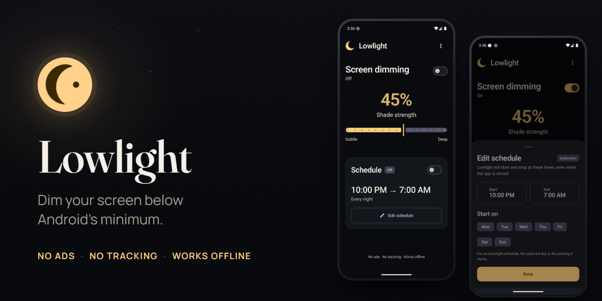

# Lowlight

[](https://github.com/ctjerm/lowlight/actions/workflows/build.yml)
[](LICENSE)


Lowlight makes your Android screen darker than the lowest brightness setting allows. It lays a dark shade over everything, so your phone stops lighting up the room when you read in bed or check it at night.

It's free and open source. No ads, no account, no tracking, and no internet permission at all.



## What it does

- Dims the screen below Android's minimum brightness. Pick a shade from 5% to 75% and change it while the shade is on.
- Leaves your phone fully usable. Taps and typing go straight through the shade to the app underneath.
- Turns on and off from the app, a Quick Settings tile, or the Stop dimming button in its notification.
- Starts and stops on a weekly schedule if you want, for example 10 PM to 7 AM every night.
- Keeps your settings on your phone. There are no analytics and no third-party SDKs.

Lowlight runs on Android 8.0 and newer.

## Get Lowlight

Download the APK from the [latest release](https://github.com/ctjerm/lowlight/releases/latest). An F-Droid release is on the way.

## Set it up

The first time you open Lowlight, it asks for up to three permissions:

| Permission | What Lowlight uses it for | When it asks |
|---|---|---|
| Display over other apps | Drawing the shade on top of other apps. The shade can't read or control what's under it. | Always. Lowlight can't dim without it. |
| Notifications | The notification that shows while dimming is on, and schedule reminders. | Android 13 and newer |
| Alarms & reminders | Starting a schedule on time without you tapping anything. | Only if you use the schedule, on Android 12 and newer |

## Use it

**Dim now.** Turn on Screen dimming and drag the slider between Subtle and Deep. To stop, turn the switch off or tap Stop dimming in the notification.

**Quick Settings tile.** Pull down the notification panel, edit your tiles, and drag Lowlight in. One tap then turns dimming on or off without opening the app.

**Schedule.** Tap Edit schedule, pick a start time, an end time and the days, then turn Schedule on. For an overnight schedule, pick the evening it starts: Friday means Friday night into Saturday morning.

The badge next to Schedule tells you what will happen:

| Badge | Meaning |
|---|---|
| Automatic | Lowlight starts and stops the shade on time, even when the app is closed. |
| Reminder | Alarms & reminders access is off. At start time Lowlight sends a notification, and you tap Start dimming. Android may deliver it, and the stop, a little late. Tap Allow automatic starts to switch to Automatic. |
| Blocked | Notifications and Alarms & reminders are both off, so the schedule has no way to reach you. |
| Permission | Display over other apps is off. |
| Check setup | No start day is selected, or the start and end times are the same. |

The schedule and manual dimming stay out of each other's way. If you stop the shade during a scheduled session, it stays off until the next session. A scheduled stop never turns off dimming you started yourself.

## Good to know

- The status bar, the keyboard and Android's own permission screens always sit above app overlays, so they can stay brighter than the rest of the screen.
- The shade stops at 75%. Above 80%, Android stops passing touches through an overlay, and your phone would ignore taps.
- While the shade is on, Android may add its own silent "displaying over other apps" notification. Android controls that one, and Lowlight can't hide it.
- If Android closes Lowlight, through force stop or a restart for example, dimming you started by hand turns off. A scheduled session comes back on after a restart.

## Privacy

Lowlight keeps its settings on your phone and has no internet permission, so it has nothing to send and no way to send it. The [privacy policy](PRIVACY_POLICY.md) has the details.

## For developers

Lowlight is a Kotlin and Jetpack Compose app. With JDK 17 or newer and Android SDK 36, this runs the unit tests and lint and builds a debug APK into `app/build/outputs/apk/debug/`:

```powershell
.\gradlew.bat testDebugUnitTest lintDebug assembleDebug
```

[docs/development.md](docs/development.md) explains how the app works and covers signed release builds, device tests and a manual test checklist. [docs/f-droid.md](docs/f-droid.md) covers F-Droid releases.

Bug reports and pull requests are welcome on the [issue tracker](https://github.com/ctjerm/lowlight/issues). Run the command above before you open a pull request, and `.\gradlew.bat connectedDebugAndroidTest` as well if you change the dimmer, the tile or the schedule.

## License

Lowlight is licensed under the GNU General Public License v3.0. See [LICENSE](LICENSE).
